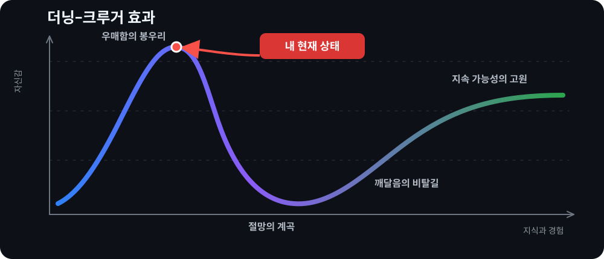

  

  2026년 포트폴리오: <a href="https://jasonwpgml.github.io">jasonwpgml.github.io</a>

  <a href="./README.md">English</a> · <strong>한국어</strong> · <a href="./README.agent.md"><code>AGENT://</code></a>

# Jason

AI 에이전트와 같이 일하면서 업무와 일상에서 반복되는 작업을 자동화하고 있습니다.
개인 에이전트와 활동·대화 기록을 정리하는 LLM 위키를 만들고, 카드 사용 내역을 모아
정리하거나 휴대폰과 데스크톱을 연결해 일을 처리하는 도구도 직접 만들어 쓰고 있습니다.

새 모델이나 에이전트에 대한 정보를 항상 찾아보고, 직접 써 보면서 실제 작업에
적용하고 있습니다. jev를 써 보고 마음에 들었고, 요즘은 clef를 즐겨 쓰면서
이것저것 실험해 보고 있습니다.

여러 에이전트에 역할을 나눠 맡기고, 작업 맥락을 공유하며 일을 이어가게 합니다.
코딩 에이전트가 프로젝트의 구조와 의도를 잘 파악할 수 있도록 작업 규칙과
코드 탐색 방식도 정리하고 있습니다.

수학을 전공했고, 9년간 강의해 왔습니다. 지금은 머신러닝·딥러닝 자격증 강의도 하고 있습니다.

여기 있는 프로젝트는 대부분 제가 쓰려고 만들기 시작했습니다.

## 근황

- **2026년 10월 6일부터** AICE 자격증 관련 회사에서 일하고 있습니다. 머신러닝·딥러닝 자격증 강의도 맡고 있습니다.
- 팀장으로 참여한 PoC를 잘 마무리했습니다. 최우수 교육생 두 명 모두 저희 팀에서 나왔습니다.

## 지금 제 위치 (제 생각입니다)

## 함께 만든 프로젝트

| 프로젝트 | 한 줄 설명 |
| --- | --- |
| [버리미](https://github.com/TrinityBalance/beorimi) | 버릴 물건을 사진으로 찍으면 강남구 기준으로 품목·규격·예상 수수료를 알려줍니다. AI가 사진을 보고, 코드는 공식 규칙에 따라 최종 판정과 금액 계산을 합니다. |
| [나의 여름방학 일기](https://github.com/TossHackathonTMD/SummerVacationDiary) | 사진 한 장과 짧은 글로 크레파스 그림일기를 만드는 토스 미니앱입니다. 선생님 첨삭과 '참 잘했어요' 도장도 넣었습니다. |
| [Publium](https://github.com/hansol-dev/team-pubmed) | PubMed 논문을 찾아 모아 두고, 그 내용을 AI에게 물어볼 수 있습니다. 답변의 근거가 된 논문 문장도 같이 보여줍니다. |
| [Intero](https://github.com/InteroGames/Intero) | 선택지 없이 직접 대답하며 형사의 취조를 버티는 게임입니다. LLM은 진술을 이해하고, 판정은 코드가 맡습니다. |
| [별일](https://github.com/TrivialOkay/TrivialOkay_toss) | 하루에 있었던 사소한 일을 기록하면 뉴스처럼 보도하고 상도 주는 토스 미니앱입니다. 기록에 운세와 엉뚱한 칭호도 붙여줍니다. |

## 지금 만들고 있는 것

| 프로젝트 | 한 줄 설명 |
| --- | --- |
| [Galpi](https://github.com/jasonwpgml/galpi) | 코딩 에이전트에게 큰 코드베이스의 구조와 현재 상태, 코드를 만든 의도를 알려주는 프로토콜입니다. Claude Code와 Codex에서 직접 측정하면서 고치고 있습니다. |
| [Autonomous Neuro Drive](https://github.com/jasonwpgml/autonomous-neuro-drive) | PC에서 한 작업과 AI와 나눈 대화를 로컬에 저장하는 LLM 위키입니다. 나중에 필요한 내용을 다시 찾아 쓸 수 있도록 정리합니다. |
| [Momento](https://github.com/jasonwpgml/Momento) | 과외·스터디 일정, 학생 정보, 수업 기록과 소통을 한곳에서 관리하는 PWA입니다. 설치 없이 휴대폰 브라우저에서 바로 쓸 수 있습니다. |
| [AQR](https://github.com/jasonwpgml/AQR) | 오래 걸리는 AI 작업을 큐에 넣어 실행하는 도구입니다. 작업이 중간에 실패해도 처음부터 다시 돌리지 않도록 만들었습니다. |

## 작지만 마음에 드는 것

| 프로젝트 | 한 줄 설명 |
| --- | --- |
| [ExRater](https://github.com/jasonwpgml/ExRater) | 실시간 환율로 금액을 계산하고, 궁금한 환율을 AI에게 물어볼 수 있는 앱입니다. |
| [drinklister](https://github.com/jasonwpgml/drinklister) | 디스코드 음료 주문을 정리하는 데스크톱 도구입니다. 누가 어떤 메뉴와 옵션을 주문했는지 정리해서 CSV로 내보냅니다. |

## 계속 궁금한 것

- 여러 에이전트가 작업 맥락을 공유하고, 역할을 나누고, 하던 일을 이어받게 하는 방법
- 코딩 에이전트가 코드를 빠르게 이해하고 안전하게 수정·검증할 수 있도록 프로젝트를 구성하는 방법
- 개인용 AI 에이전트와 LLM 위키에 쌓인 활동·대화 기록을 나중에도 찾아 쓸 수 있게 정리하는 방법
- 에이전트의 기억을 원본 기록, 이벤트 저장소, 검색 인덱스로 나누고 데이터의 출처와 변화를 기록하는 방법, 그리고 어디까지 로컬에 둘지
- 새 모델, 에이전트 도구, MCP 같은 프로토콜을 써 보고 실제로 계속 쓸 만한지 확인하는 것

## 자주 쓰는 도구

**AI 도구** (많이 쓰는 순서):
`Claude (Max)` → `Codex (Pro)` → `Cursor / Grok / grok-bot (Premium)` → `jev` → `Gemini`

**로컬 모델:** `clef` (요즘 가장 많이 씁니다) · `laya` · `Qwen` · `Gemma 4`

**개발할 때 쓰는 기술:** `MCP` · `LangGraph` · `LangChain` · `OpenAI API` · `Transformers` · `RAG` · `pgvector` · `멀티 에이전트 시스템` · `장기 기억` · `Event Store` · `데이터 계보` · `Streamlit`

  

<!--START_SECTION:ai_usage-->
## 지금까지 태운 토큰

AI 도구(Claude Code, Codex, Cursor, Grok)가 저 대신 읽고 쓴 토큰을 [tokscale](https://github.com/junhoyeo/tokscale)로 로컬 로그에서 합산했습니다.
밖으로 나가는 건 합계뿐입니다.

<!--END_SECTION:ai_usage-->

## 기여 기록

## 라이선스

© 2026 Jason ([@jasonwpgml](https://github.com/jasonwpgml)). 이 저장소의 원본
콘텐츠는 [CC BY 4.0](./LICENSE)으로 배포합니다. 자유롭게 가져가 고쳐 써도 좋지만,
**이 프로필을 바탕으로 만들었다는 출처는 잘 보이는 곳에 남겨 주세요.** 바로 복사해
쓸 수 있는 표기 예시는 [ATTRIBUTION.md](./ATTRIBUTION.md)에 정리해 두었습니다.

<!-- © 2026 Jason (github.com/jasonwpgml) · CC BY 4.0 · 이 프로필을 변형해 쓸 경우 이 표시 또는 그에 준하는 크레딧을 유지해 주세요. -->
