

  <a href="https://jasonwpgml.github.io"></a>

  2026년 포트폴리오: <a href="https://jasonwpgml.github.io">jasonwpgml.github.io</a>

  <a href="./README.md">English</a> · <strong>한국어</strong> · <a href="./README.agent.md"><code>AGENT://</code></a>

# Jason

**시각화 교안과 에이전트 자동화**

지식의 최첨단을 탐색하는 탐험가, Jason입니다. 
새로운 기술을 매일 찾아다니고 직접 써보며 떠오른 아이디어를 테스트합니다. 
수학을 전공하고, 10년째 강의하고 있습니다. 수학에 더해 지금은 머신러닝, 딥러닝 및 AI 기술 강의도 진행 중입니다.

채용 제안과 강의·출강 문의 모두 환영합니다. 
[jae1450@naver.com](mailto:jae1450@naver.com) · [브런치](https://brunch.co.kr/@f7e7d204a7f744f) · [포트폴리오](https://jasonwpgml.github.io) · [프로젝트 설명은 아래에](#프로젝트)

## 근황

- **2026.10.06** AICE 교육 회사 입사, 머신러닝·딥러닝 자격증 강의
- **2026.09** 베어러블 PoC 완료 (팀장)
- **2026.07 – 08** 앱인토스 미니앱 2종 정식 출시

## 지금 제 위치 (제 생각입니다)

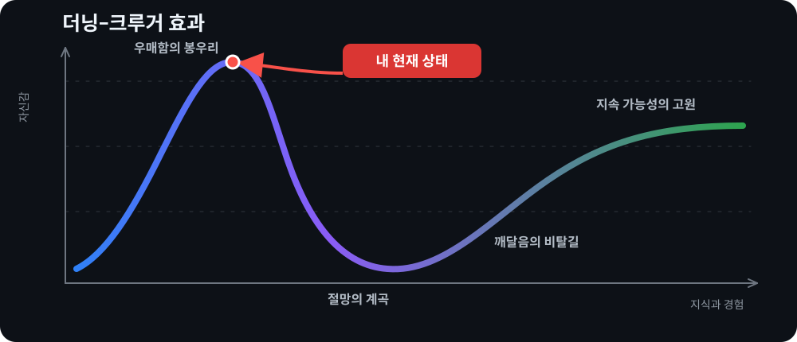

## 자주 쓰는 도구

**AI 도구** (많이 쓰는 순서):
`Claude (Max)` → `Codex (Pro)` → `Cursor / Grok / grok-bot (Premium)` → `jev` → `Gemini`

**로컬 모델:** `clef` (요즘 가장 많이 씁니다) · `laya` · `Qwen` · `Gemma 4`

**개발할 때 쓰는 기술:** `MCP` · `LangGraph` · `LangChain` · `OpenAI API` · `Transformers` · `RAG` · `pgvector` · `멀티 에이전트 시스템` · `장기 기억` · `Event Store` · `데이터 계보` · `Streamlit`

**관심사:** `에이전트 간 맥락 공유와 인수인계` · `에이전트 친화 코드베이스` · `LLM 위키` · `원본 기록, 이벤트 저장소, 검색 인덱스` · `로컬과 클라우드 경계` · `새 모델과 에이전트 도구`

  

<!--START_SECTION:ai_usage-->
## 지금까지 태운 토큰

AI 도구(Claude Code, Codex, Cursor, Grok)가 저 대신 읽고 쓴 토큰을 [tokscale](https://github.com/junhoyeo/tokscale)로 로컬 로그에서 합산했습니다.
밖으로 나가는 건 합계뿐입니다.


<!--END_SECTION:ai_usage-->

## 기여 기록

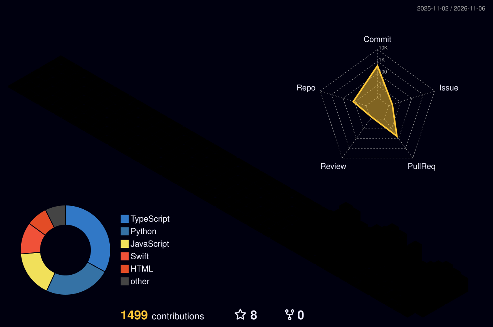

## 프로젝트

### 01 시각화 교안과 강의

AI 교육 회사 · 교안 제작, 강의 · 고등학교, 대학교 AI 자격증 강의 출강 · 2026.10 –

#### 3D 음성 강의

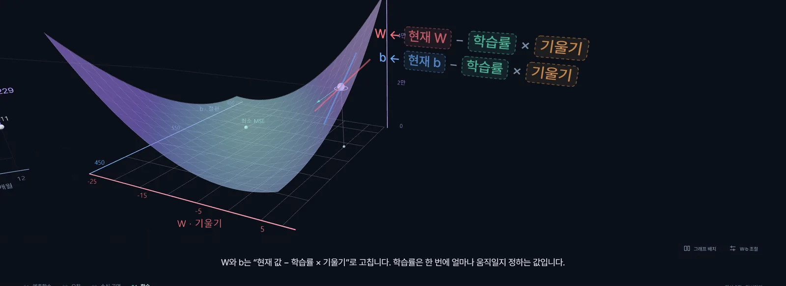

경사하강법: 손실 곡면 위에서 W와 b 갱신

`선형회귀` `MSE` `손실 곡면` `경사하강법` `three.js` `음성 내레이션`

#### 모델 실험실

<table>
  <tr>
    <td width="33%">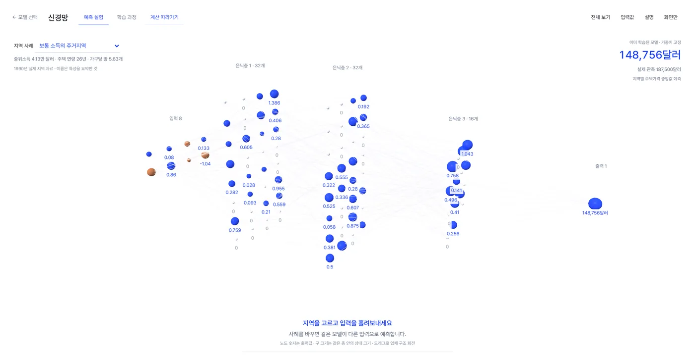</td>
    <td width="33%">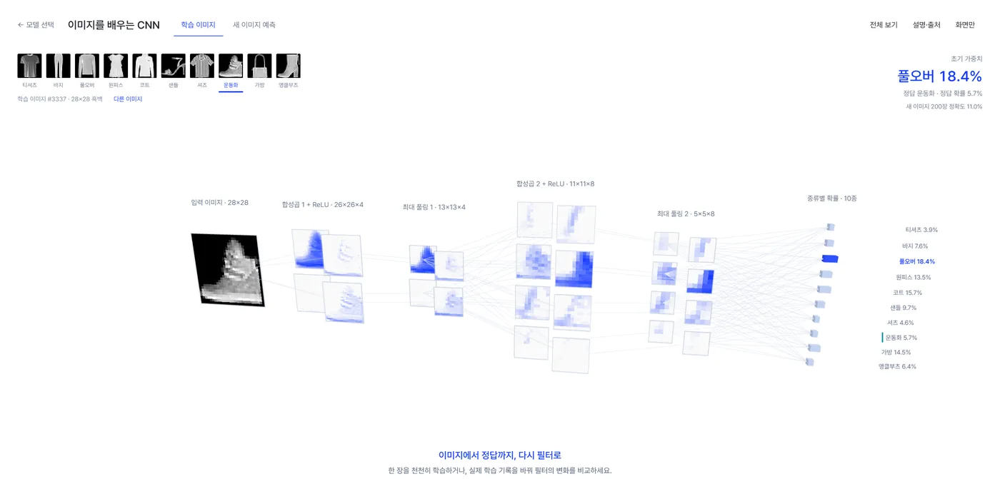</td>
    <td width="33%">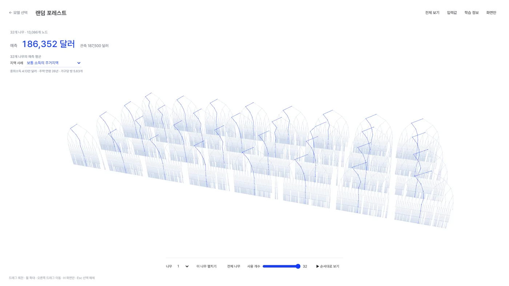</td>
  </tr>
  <tr>
    <td>신경망: 순전파와 역전파</td>
    <td>CNN: 필터와 특징 맵</td>
    <td>랜덤 포레스트: 나무 32그루의 평균</td>
  </tr>
</table>

`모델 6종` `실제 데이터로 학습` `Fashion-MNIST` `계산 따라가기` `three.js`

#### 동적 교안

<table>
  <tr>
    <td width="50%">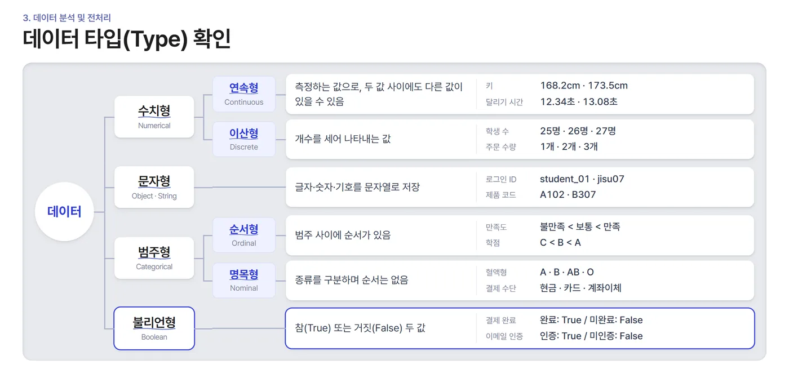</td>
    <td width="50%">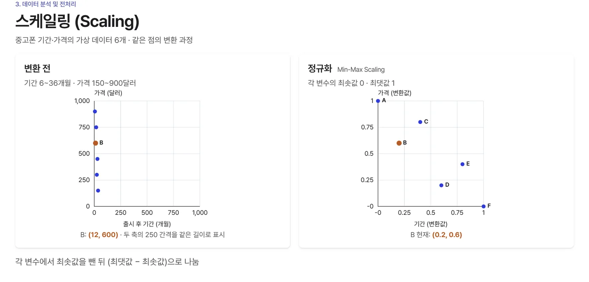</td>
  </tr>
  <tr>
    <td>데이터 타입 트리</td>
    <td>스케일링 전후 비교</td>
  </tr>
</table>

`AICE Basic` `고등학생, 비전공자 대상` `75쪽` `단계별 애니메이션` `HTML, CSS, JS` `Apple Pencil 판서`

### 02 AgentHub

개인 프로젝트 · 사용 중 · 2026.10 –

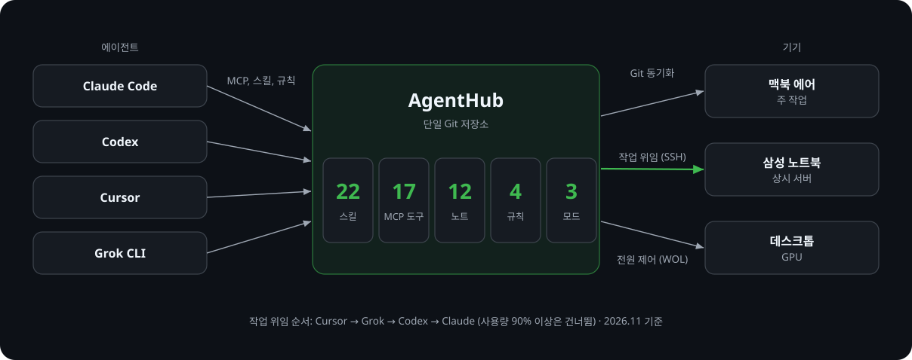

`MCP` `Agent Skills` `Node.js` `SQLite` `Tailscale` `SSH` `REST, OpenAPI`

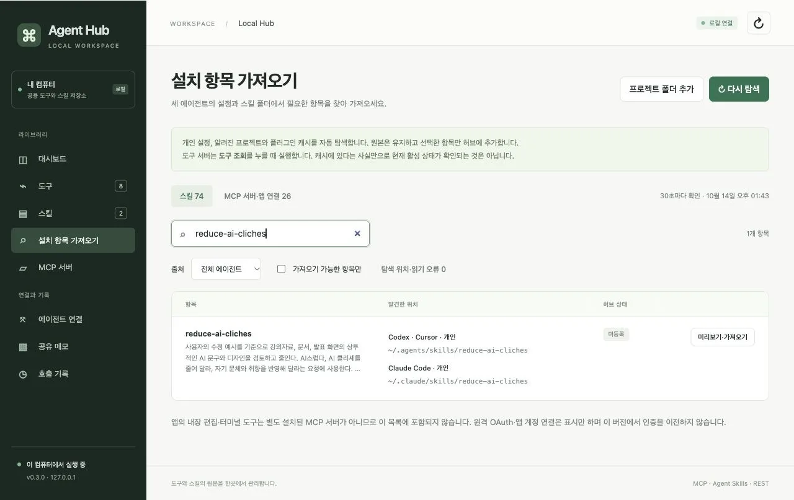

설치된 스킬과 도구 검색

`웹 관리 화면` `스킬 검색과 공유` `일회용 링크 로그인` `저장소 비공개`

### 03 AND

Autonomous Neuro Drive · 사용 중 · 2026.08 –

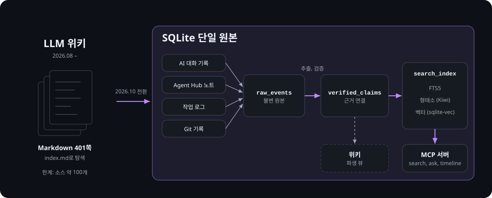

`로컬 우선` `SQLite` `FTS5` `sqlite-vec` `Kiwi 형태소 분석` `Ollama` `MCP`

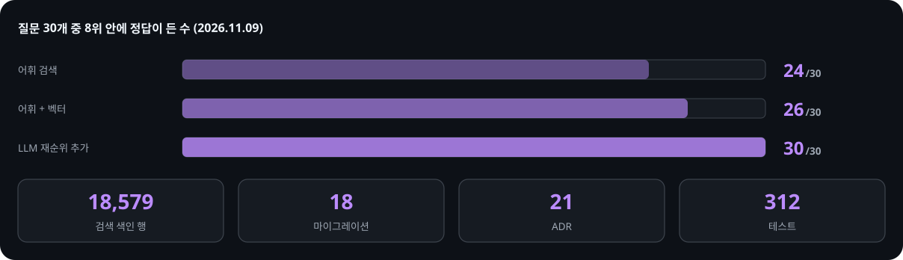

`하이브리드 검색` `snowflake-arctic-embed2` `답 없는 질문은 응답 보류` `저장소 비공개`

### 04 그록봇과 에이전트 자동화

개인 자동화 · 사용 중 · 2026.08 –

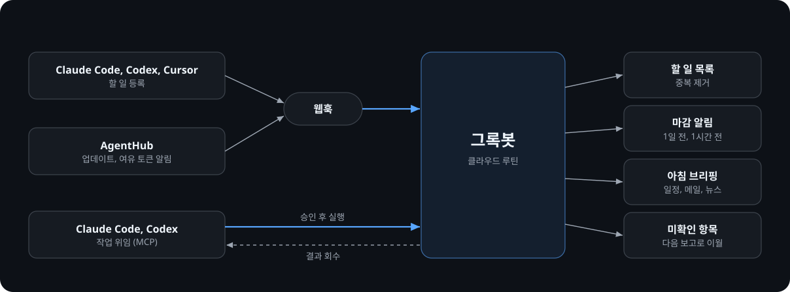

`MCP` `웹훅` `클라우드 에이전트` `승인 게이트` `JSONL 위임 기록`

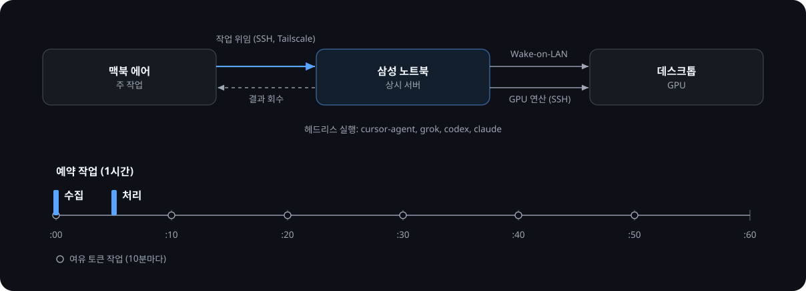

`agent_dispatch` `Tailscale` `SSH` `Wake-on-LAN` `작업 스케줄러`

### 05 그 밖의 프로젝트

#### 팀 프로젝트

| 프로젝트 | 기간, 역할 | 키워드 |
| --- | --- | --- |
| 베어러블 PoC | 2026.08 – 09 5인 팀, 팀장 | `수강계획 Agent` `고교학점제` `최우수 교육생 2명 모두 우리 팀` `React` `Vite` `Vercel` · 기업 연계, 저장소 비공개 |
| [Publium](https://github.com/hansol-dev/team-pubmed) | 2026.07 2인 팀, 8일 백엔드, 검색 Agent | `PubMed` `PMID 근거 표시` `FastAPI` `LangChain 툴콜링` `Supabase Postgres` · [서비스](https://team-pubmed.vercel.app) |
| [버리미](https://github.com/TrinityBalance/beorimi) | 2026.08 3인 팀, 28시간 팀장, 백엔드 | `VLM 다중 품목 인식` `Structured Outputs` `Postgres 큐` `Next.js` `Supabase` · [서비스](https://frontend-delta-red-74.vercel.app/) |
| [나의 여름방학 일기](https://github.com/TossHackathonTMD/SummerVacationDiary) [별일](https://github.com/TrivialOkay/TrivialOkay_toss) | 2026.07 – 08 정식 출시 기획 주도, 팀장 | `앱인토스 미니앱` `크레파스 그림일기` `운세와 칭호` `React` `TypeScript` `three.js` |
| [Intero](https://github.com/InteroGames/Intero) | 2026.08 | `취조 게임` `선택지 없는 답변` `LLM은 진술 이해, 판정은 코드` |

#### 개인 도구

| 도구 | 키워드 |
| --- | --- |
| [Galpi](https://github.com/jasonwpgml/galpi) | `코딩 에이전트용 코드 탐색` `.galpi 인덱스` `Claude Code, Codex` `A/B 실험` |
| [Poom](https://github.com/jasonwpgml/poom) | `로컬 모델 위임` `Ollama` `결과 검증` |
| [AQR](https://github.com/jasonwpgml/AQR) | `AI 작업 큐` `우선순위, 의존성` `git worktree 병렬` `Draft PR` |
| 나비서 | `MCP` `Android 자동화` `결제 차단` `비공개` |
| FAPA | `Playwright MCP` `카드 내역 수집` `지출 정리` `비공개` |
| Momento | `과외 일정 PWA` `강사, 학생, 보호자` `1인 개발과 운영` `비공개` |
| cogito | `개인 AI 에이전트` `에이전트와 코드의 분담 실험` `비공개` |
| [ExRater](https://github.com/jasonwpgml/ExRater) | `실시간 환율 계산` `환율 질문 AI` |
| [drinklister](https://github.com/jasonwpgml/drinklister) | `디스코드 음료 주문 정리` `데스크톱 GUI` `CSV 내보내기` |

## 라이선스

© 2026 Jason ([@jasonwpgml](https://github.com/jasonwpgml)). 이 저장소의 원본
콘텐츠는 [CC BY 4.0](./LICENSE)으로 배포합니다. 자유롭게 가져가 고쳐 써도 좋지만,
**이 프로필을 바탕으로 만들었다는 출처는 잘 보이는 곳에 남겨 주세요.** 바로 복사해
쓸 수 있는 표기 예시는 [ATTRIBUTION.md](./ATTRIBUTION.md)에 정리해 두었습니다.

<!-- © 2026 Jason (github.com/jasonwpgml) · CC BY 4.0 · 이 프로필을 변형해 쓸 경우 이 표시 또는 그에 준하는 크레딧을 유지해 주세요. -->
