

  

  2026 portfolio: <a href="https://jasonwpgml.github.io/en/">jasonwpgml.github.io</a>

  <strong>English</strong> · <a href="./README.ko.md">한국어</a> · <a href="./README.agent.md"><code>AGENT://</code></a>

# Jason

**Visual lecture materials and agent automation**

I’m Jason, an explorer at the frontier of knowledge. 
Every day I look for new technology, try it myself, and test the ideas that come from it. 
I majored in math and have been teaching for 10 years. Besides math, I now also teach machine learning, deep learning and AI.

Job offers and teaching inquiries are both welcome. 
[jae1450@naver.com](mailto:jae1450@naver.com) · [Brunch](https://brunch.co.kr/@f7e7d204a7f744f) · [Portfolio](https://jasonwpgml.github.io/en/) · [Projects below](#projects)

## News

- **2026.10.06** Joined an AICE education company; teaching ML and DL certification courses
- **2026.09** Bearable PoC completed (team lead)
- **2026.07 – 08** Two Apps in Toss mini apps launched

## Where I think I am

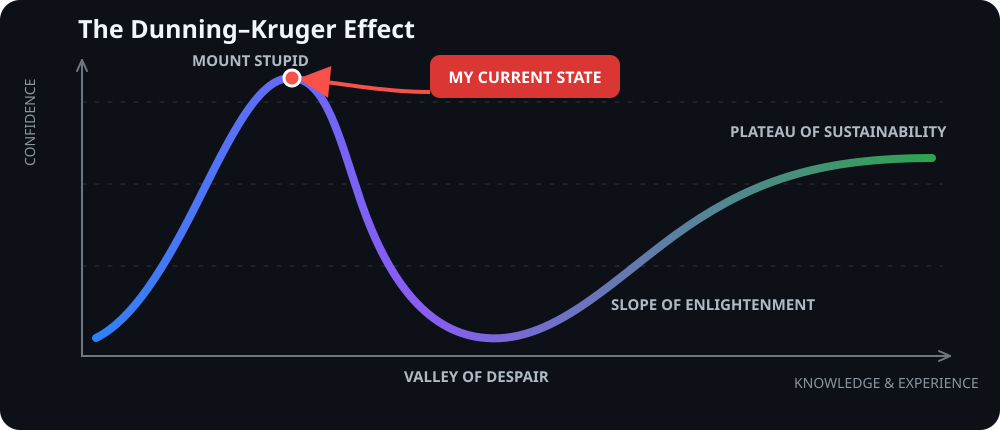

## What I reach for

**Daily drivers**, most-used first:
`Claude (Max)` → `Codex (Pro)` → `Cursor / Grok / grok-bot (Premium)` → `jev` → `Gemini`

**Running locally:** `clef` (using this one a lot lately) · `laya` · `Qwen` · `Gemma 4`

**Building with:** `MCP` · `LangGraph` · `LangChain` · `OpenAI API` · `Transformers` · `RAG` · `pgvector` · `Multi-agent Systems` · `Long-term Memory` · `Event Store` · `Data Provenance` · `Streamlit`

**Interests:** `Context sharing and handoff between agents` · `Agent-friendly codebases` · `LLM wikis` · `Raw records, event stores, search indexes` · `Local vs. cloud boundaries` · `New models and agent tools`

  

<!--START_SECTION:ai_usage-->
## Tokens I've burned

Everything Claude Code, Codex, Cursor and Grok have read and written for me, summed from local logs
with [tokscale](https://github.com/junhoyeo/tokscale). Only the totals leave my machine.


<!--END_SECTION:ai_usage-->

## Contributions

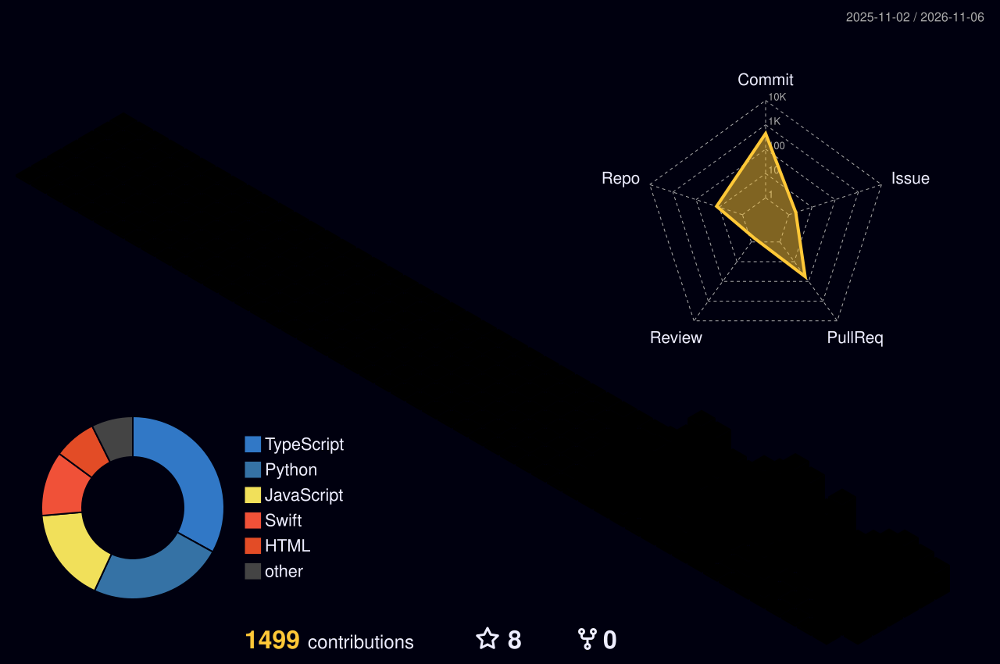

## Projects

### 01 Lecture materials and teaching

AI education company · Course materials, teaching · AI certification courses at high schools and universities · 2026.10 –

#### 3D voice lecture

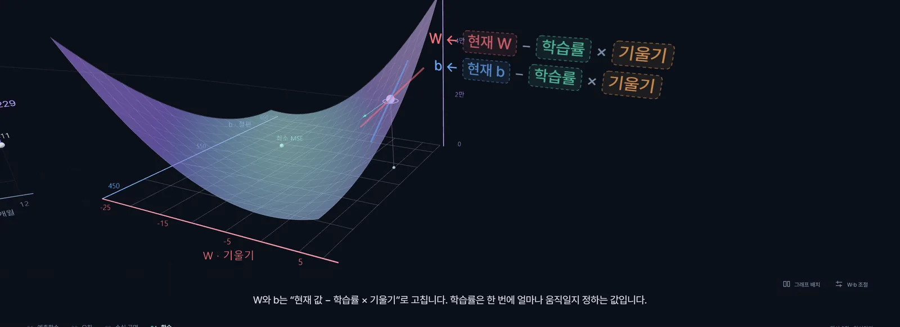

Gradient descent: updating W and b on the loss surface

`Linear regression` `MSE` `Loss surface` `Gradient descent` `three.js` `Voice narration`

#### 3D model lab

<table>
  <tr>
    <td width="33%">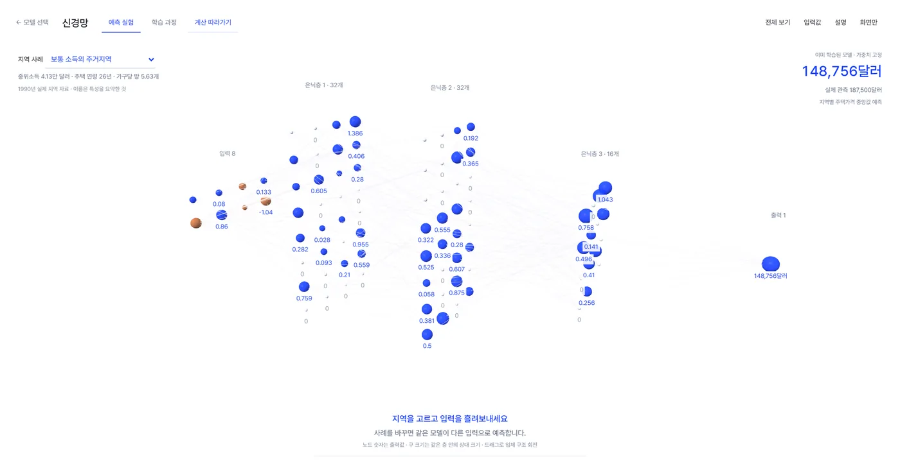</td>
    <td width="33%">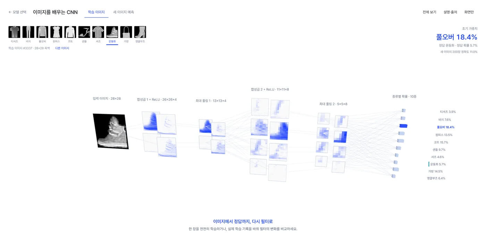</td>
    <td width="33%">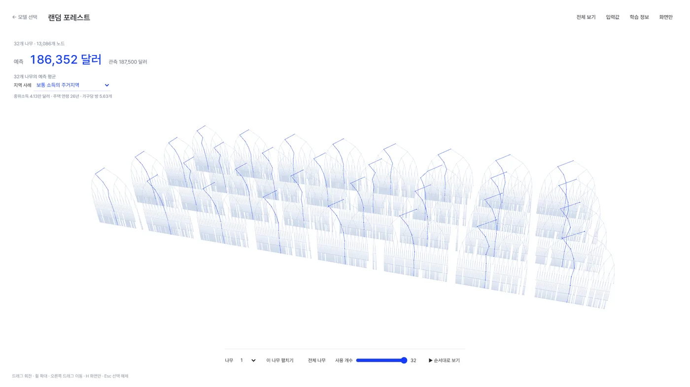</td>
  </tr>
  <tr>
    <td>Neural network: forward and backward pass</td>
    <td>CNN: filters and feature maps</td>
    <td>Random forest: the average of 32 trees</td>
  </tr>
</table>

`6 models` `Trained on real data` `Fashion-MNIST` `Step-through calculation` `three.js`

#### Interactive deck

<table>
  <tr>
    <td width="50%">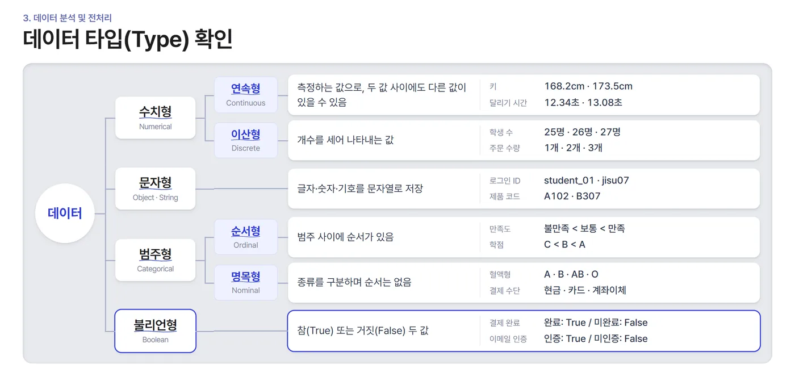</td>
    <td width="50%">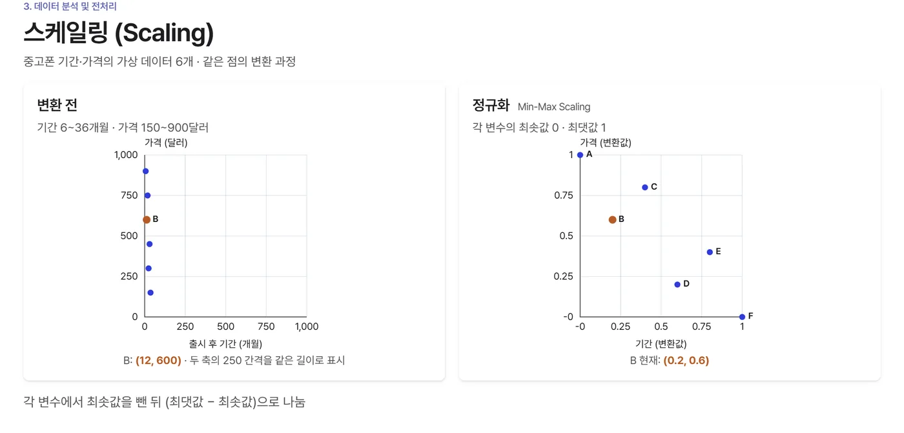</td>
  </tr>
  <tr>
    <td>Data type tree</td>
    <td>Before and after scaling</td>
  </tr>
</table>

`AICE Basic` `For high school students and non-majors` `75 pages` `Step-by-step animation` `HTML, CSS, JS` `Apple Pencil annotation`

### 02 AgentHub

Personal project · In use · 2026.10 –

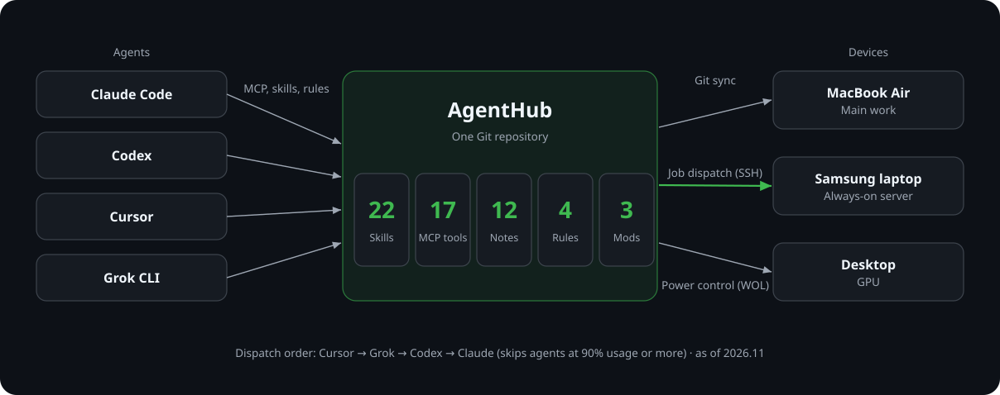

`MCP` `Agent Skills` `Node.js` `SQLite` `Tailscale` `SSH` `REST, OpenAPI`

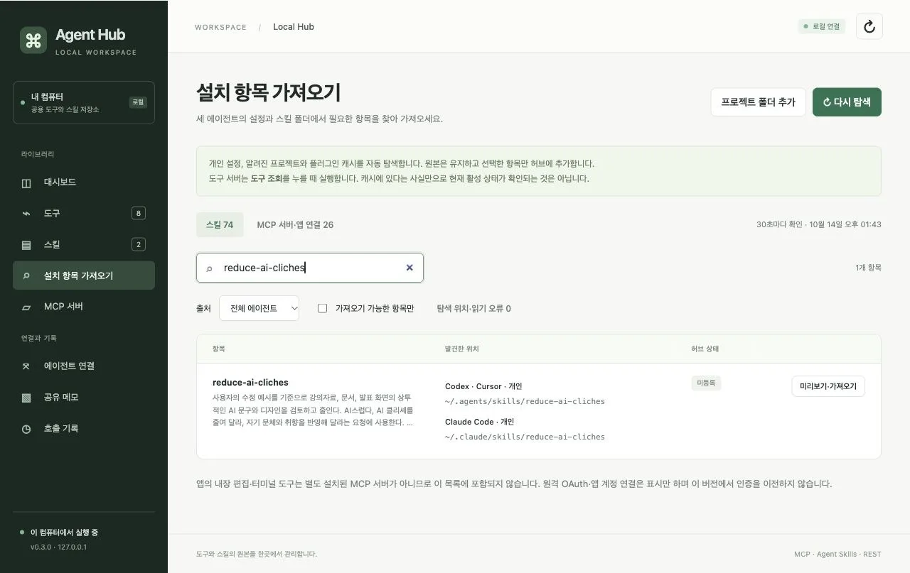

Searching installed skills and tools

`Web admin screen` `Skill search and sharing` `One-time link login` `Private repo`

### 03 AND

Autonomous Neuro Drive · In use · 2026.08 –

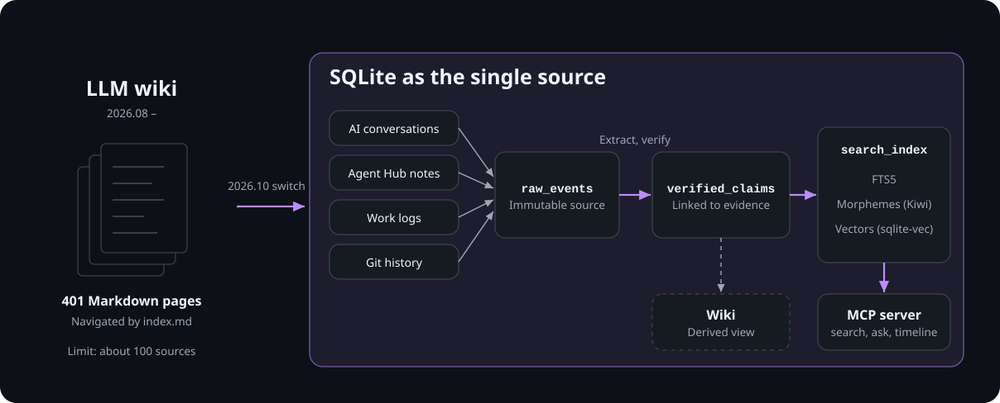

`Local-first` `SQLite` `FTS5` `sqlite-vec` `Kiwi morphological analysis` `Ollama` `MCP`

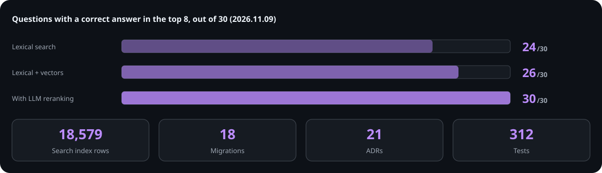

`Hybrid search` `snowflake-arctic-embed2` `Abstains when there is no answer` `Private repo`

### 04 Grok bot and agent automation

Personal automation · In use · 2026.08 –

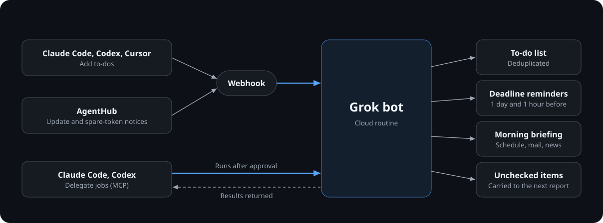

`MCP` `Webhook` `Cloud agent` `Approval gate` `JSONL delegation log`

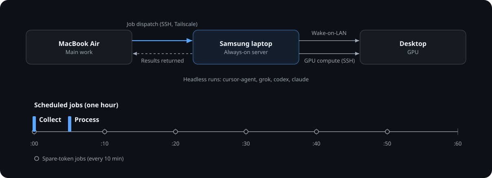

`agent_dispatch` `Tailscale` `SSH` `Wake-on-LAN` `Task Scheduler`

### 05 Other projects

#### Team projects

| Project | Period, role | Keywords |
| --- | --- | --- |
| Bearable PoC | 2026.08 – 09 Team of 5, team lead | `Course-planning agent` `High school credit system` `Both top-trainee awards went to our team` `React` `Vite` `Vercel` · Company-linked, private repo |
| [Publium](https://github.com/hansol-dev/team-pubmed) | 2026.07 Team of 2, 8 days Backend, search agent | `PubMed` `PMID citations` `FastAPI` `LangChain tool calling` `Supabase Postgres` · [Service](https://team-pubmed.vercel.app) |
| [Beorimi](https://github.com/TrinityBalance/beorimi) | 2026.08 Team of 3, 28 hours Team lead, backend | `Multi-item VLM detection` `Structured Outputs` `Postgres queue` `Next.js` `Supabase` · [Service](https://frontend-delta-red-74.vercel.app/) |
| [My Summer Vacation Diary](https://github.com/TossHackathonTMD/SummerVacationDiary) [Byeolil](https://github.com/TrivialOkay/TrivialOkay_toss) | 2026.07 – 08 Officially launched Planning lead, team lead | `Apps in Toss mini apps` `Crayon picture diary` `Fortunes and titles` `React` `TypeScript` `three.js` |
| [Intero](https://github.com/InteroGames/Intero) | 2026.08 | `Interrogation game` `No dialogue options` `LLM reads statements, code decides` |

#### Personal tools

| Tool | Keywords |
| --- | --- |
| [Galpi](https://github.com/jasonwpgml/galpi) | `Code navigation for coding agents` `.galpi index` `Claude Code, Codex` `A/B experiments` |
| [Poom](https://github.com/jasonwpgml/poom) | `Local model delegation` `Ollama` `Result validation` |
| [AQR](https://github.com/jasonwpgml/AQR) | `AI task queue` `Priorities, dependencies` `Parallel git worktrees` `Draft PRs` |
| Nabiseo | `MCP` `Android automation` `Payment blocked` `Private` |
| FAPA | `Playwright MCP` `Card statement collection` `Expense tracking` `Private` |
| Momento | `Tutoring schedule PWA` `Tutor, student, guardian` `Solo build and operation` `Private` |
| cogito | `Personal AI agent` `Agent vs. code experiments` `Private` |
| [ExRater](https://github.com/jasonwpgml/ExRater) | `Live exchange rates` `Ask AI about rates` |
| [drinklister](https://github.com/jasonwpgml/drinklister) | `Discord drink orders` `Desktop GUI` `CSV export` |

## License

© 2026 Jason ([@jasonwpgml](https://github.com/jasonwpgml)). Original content in
this repo is licensed under [CC BY 4.0](./LICENSE) — reuse and adapt freely, but
**keep a visible credit** that your work is based on this repository. Ready-made
credit snippets live in [ATTRIBUTION.md](./ATTRIBUTION.md).

<!-- profile-readme-refresh -->
<!-- © 2026 Jason (github.com/jasonwpgml) · CC BY 4.0 · If you adapt this profile, keep this notice or an equivalent credit. -->
