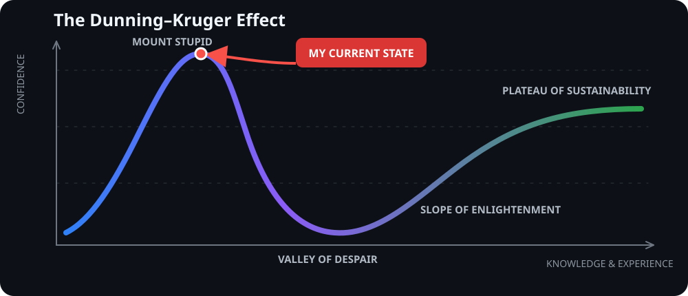
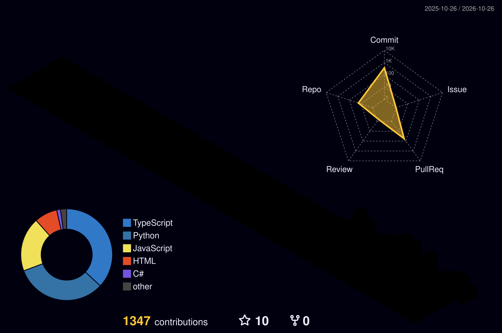

  

  <strong>English</strong> · <a href="./README.ko.md">한국어</a> · <a href="./README.agent.md"><code>AGENT://</code></a>

# Jason

### On the bleeding edge of the agent era, building how people and agents work together. Occasionally bleeding.

I spend most of my time where AI agents are changing fastest. When a new model or
agent tool lands, I try it, build something with it, and find out where it breaks.

That mostly comes down to three things:

- **Build.** Personal agents, an LLM wiki that turns what I do and say into
  long-term memory, and team products where the model observes and the code decides.
- **Experiment.** How agents share context, split roles, and hand off work without
  losing intent, and how to shape codebases that coding agents can find their way
  around. Measured on more than one agent, because one is not evidence.
- **Teach.** Machine learning and deep learning certification courses, so what I
  learned by bleeding, other people can learn with fewer cuts.

Most of what's here started because I wanted to use it myself.

Portfolio, 2026 edition: [jasonwpgml.github.io](https://jasonwpgml.github.io)

## Lately

- **Since Oct 6, 2026**, I've been working at a company working on the AICE AI certification, and I also teach machine learning and deep learning certification courses.
- I led my team through our PoC and we wrapped it up well. Both top-trainee awards in the program went to people on that team.

## Where I currently am (allegedly)

## Built with other people

| Project | The short version |
| --- | --- |
| [Beorimi](https://github.com/TrinityBalance/beorimi) | Photograph the junk you want to throw out and it figures out the category and the disposal fee under Gangnam-gu's rules. The AI looks at the photo, the code does the pricing. |
| [My Summer Vacation Diary](https://github.com/TossHackathonTMD/SummerVacationDiary) | A Toss mini app that turns one photo and a few lines into a crayon picture diary. A teacher marks it up and stamps it. |
| [Publium](https://github.com/hansol-dev/team-pubmed) | A workspace for collecting PubMed papers and then talking to them. It shows which sentence an answer came from, not just the answer. |
| [Intero](https://github.com/InteroGames/Intero) | An interrogation game you survive by lying. There are no dialogue options, so whatever you say is whatever you make up. |
| [Byeolil](https://github.com/TrivialOkay/TrivialOkay_toss) | A Toss mini app that takes the most ordinary thing that happened to you today, records it with complete seriousness, and hands back a fortune and an honorary title. |

## What I'm working on

| Project | The short version |
| --- | --- |
| [Galpi](https://github.com/jasonwpgml/galpi) | A navigation protocol that helps coding agents find their way around a codebase. Tested on more than one agent, because one is not evidence. |
| [Autonomous Neuro Drive](https://github.com/jasonwpgml/autonomous-neuro-drive) | A local-first LLM wiki. Everything I do and talk about goes in, and hopefully comes back out as something I can still use next year. |
| [Momento](https://github.com/jasonwpgml/Momento) | Scheduling PWA for tutoring and study groups. Full stack, and yes, it has to work on a phone. |
| [AQR](https://github.com/jasonwpgml/AQR) | A queue-based runner for AI workflows, so a long job failing halfway isn't the end of the world. |

## Smaller things I still like

| Project | The short version |
| --- | --- |
| [ExRater](https://github.com/jasonwpgml/ExRater) | Live exchange rates, with an AI search you can just talk to. |
| [drinklister](https://github.com/jasonwpgml/drinklister) | Turns messy Discord drink orders into clean, exportable data. Exactly as niche as it sounds. |

## What I keep thinking about

- Agent-to-agent communication: exchanging context, dividing roles, and handing work off without losing intent
- Agent-friendly development: codebases that coding agents can navigate, change, and verify reliably
- Personal agents and LLM wikis that turn activity and conversations into durable knowledge
- Memory for agents: raw archives, event stores, search indexes, provenance, and local/cloud boundaries
- Keeping up with the agent ecosystem: new models, agent tools, and protocols like MCP, and which of them survive real use

## What I reach for

**Daily drivers**, most-used first:
`Claude (Max)` → `Codex (Pro)` → `Cursor / Grok / grok-bot (Premium)` → `jev` → `Gemini`

**Running locally:** `clef` (using this one a lot lately) · `laya` · `Qwen` · `Gemma 4`

**Building with:** `MCP` · `LangGraph` · `LangChain` · `OpenAI API` · `Transformers` · `RAG` · `pgvector` · `Multi-agent Systems` · `Long-term Memory` · `Event Store` · `Data Provenance` · `Streamlit`

  

<!--START_SECTION:ai_usage-->
## Tokens I've burned

Everything Claude Code, Codex and Grok have read and written for me, summed from local logs
with [tokscale](https://github.com/junhoyeo/tokscale). Only the totals leave my machine.

<!--END_SECTION:ai_usage-->

## Contributions

## License

© 2026 Jason ([@jasonwpgml](https://github.com/jasonwpgml)). Original content in
this repo is licensed under [CC BY 4.0](./LICENSE) — reuse and adapt freely, but
**keep a visible credit** that your work is based on this repository. Ready-made
credit snippets live in [ATTRIBUTION.md](./ATTRIBUTION.md).

<!-- profile-readme-refresh -->
<!-- © 2026 Jason (github.com/jasonwpgml) · CC BY 4.0 · If you adapt this profile, keep this notice or an equivalent credit. -->
